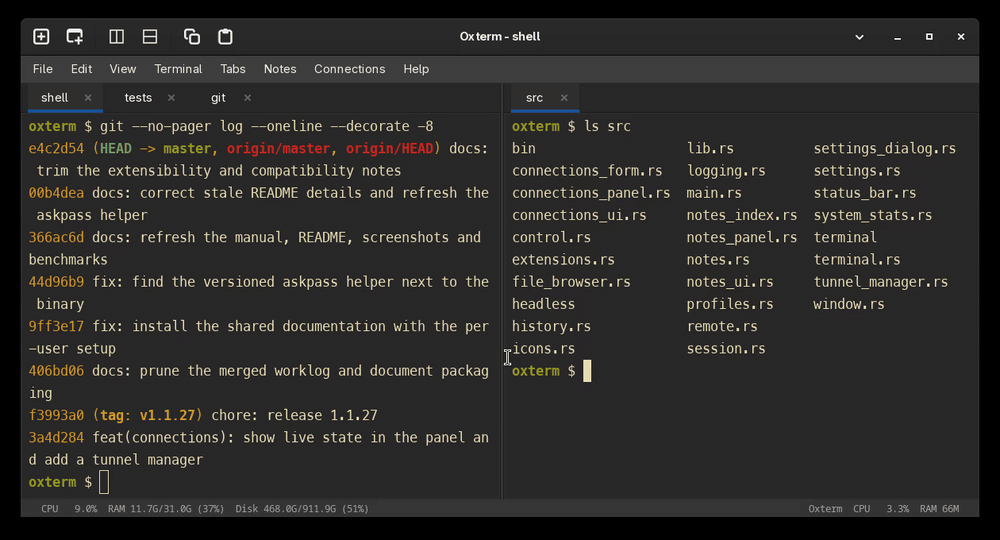

# Oxterm

[](https://github.com/buzzqw/oxterm/actions/workflows/ci.yml)
[](https://github.com/buzzqw/oxterm/actions/workflows/build.yml)
[](https://www.rust-lang.org/)
[](https://www.gtk.org/)
[](LICENSE)

**Oxterm** is a **lightweight, blazing fast, and secure** native Linux terminal emulator written in Rust with GTK3 and VTE. It combines the speed, small footprint, and memory-safety of Rust with modern power-user features: tabs, tmux-style split panes, persistent sessions, SSH management, full-text notes, command history, and optional AI agent integration.

---

## Quick Navigation

- 📖 **[User Manual](manual.md)** — Comprehensive user guide and walkthroughs
- 📊 **[Performance & Benchmarks](docs/benchmarks.md)** — Detailed profiling, latency tests, and comparative benchmarks
- ⚙️ **[Settings Reference](docs/settings.md)** — Exhaustive list of all configuration options
- 🔌 **[Extensibility & Automation](docs/extensibility.md)** — Scripting API, triggers, and workspace specs
- 🐧 **[Terminal Compatibility](docs/compatibility.md)** — VTE requirements and desktop integration
- 🐛 **[Report an Issue](https://github.com/buzzqw/oxterm/issues)** — Bug reports and feature suggestions

---

## Screenshots




| Split Panes | Command Bar | Connections Manager |
| :---: | :---: | :---: |
|  |  |  |

---

## Key Highlights

### 🪟 Multiplexing & Layouts
- **Tmux-style split panes**: Single, vertical, and horizontal splits with a configurable prefix key (`Ctrl+B` by default).
- **Advanced tab management**: Reorder, rename, detach into new windows, or adopt running tabs across windows (*Tabs > Move Tab from Another Oxterm…*).
- **Broadcast input**: Type simultaneously across all active split panes.

### ⚡ Persistent PTY Broker (<3 MB RAM)
- **Crash & close resilience**: Terminal sessions are managed by an independent, display-free broker process (`oxterm-broker`). If the GUI closes or crashes, your shell keeps running.
- **Remote attach & detach**: Seamlessly re-attach to sessions locally or over SSH via `oxterm -a` or `oxterm -M`.
- **Tiny footprint**: The headless broker consumes under **3 MB of resident RAM** per session.

### 🌐 Connection Manager & Remote Tools
- **Connections & tunnels**: Searchable panel for SSH, Mosh, Telnet, Serial, Docker, Kubernetes, AWS Session Manager, and RDP/VNC/SPICE.
- **Built-in SFTP/FTP file browser**: Two-pane browser with drag-and-drop, remote file editing (uploads on save), and directory synchronization.
- **Production safety**: Automatic visual badges and warnings for production hosts, active SSH tunnels, and `ForwardAgent yes`.

### 🐚 OSC 133 Shell Integration
- **Command boundaries & status**: Automatically identifies prompts, command execution, and exit codes.
- **Smart notifications**: Desktop alerts only trigger for long-running (>10s) or failed commands when the terminal is unfocused.
- **Visual failure markers**: Tabs with failed commands display a subtle red dot indicator until selected.
- **Smart Open**: Context menus and hint mode (`Ctrl+Shift+H`) detect `path:line:col` in output and jump directly to that line in your configured editor.

### 🤖 Optional AI Agent Integration
- **Opt-in & transparent**: Disabled by default; zero background overhead or network calls unless configured.
- **Dedicated Agent Pane (`Ctrl+Shift+.`)**: Native ACP (Agent Client Protocol) interface with session persistence per tab.
- **`oxterm fix`**: Instant diagnostics sending failed command output, directory, and status directly to the agent.
- **`?prompt` syntax**: Type `?` at the shell prompt to ask the agent directly without running the command.
- **Model Context Protocol (`oxterm mcp`)**: Built-in MCP server on stdio with an audit log and fine-grained permission policies.

### 🎨 Customization & Typography
- **247 built-in themes**: Catppuccin, Dracula, Tokyo Night, Gruvbox, Nord, Solarized, and more, plus support for Ghostty and iTerm2 `.itermcolors` theme files.
- **Automatic light/dark switching**: Dynamically follows your desktop environment theme preference.
- **Typography controls**: Cell height/width scaling, subpixel antialiasing, optional HarfBuzz text shaping, and ligature support.

### 🛠️ Power-User Productivity
- **VI Copy Mode (`Ctrl+Shift+Y`)**: Vim-like keyboard navigation, text objects, visual block selection, and motions.
- **SQLite command history**: Searchable history with reverse search, duration tracking, Git branch metadata, and read-only SQL queries (`/history :sql`).
- **Markdown Notes**: Built-in full-text search (SQLite FTS5) notes panel with `#tags`, previews, and quick clipping from terminal output.
- **Global Command Palette (`Ctrl+Shift+P`)**: Fuzzy search over actions, settings, and built-in slash commands.

---

## Performance at a Glance

Oxterm consistently delivers industry-leading startup and payload throughput while maintaining a minimal memory footprint.

*Measured on an AMD Ryzen 7 5800H running Linux (CachyOS, kernel 7.3.3) under identical default settings:*

| Metric | Oxterm | Ghostty 1.4.0 | Alacritty 0.17.0 | xfce4-terminal 1.2.0 |
| :--- | :---: | :---: | :---: | :---: |
| **Time to first interactive shell** | **102 ms** | 577 ms | 243 ms | 231 ms |
| **Drain 100k ANSI-coloured lines** | **89 ms** | 144 ms | 248 ms | 229 ms |
| **Drain 100k plain lines** | **81 ms** | 127 ms | 241 ms | 193 ms |
| **Idle tree RSS** | 96.4 MiB | 201.1 MiB | 133.6 MiB | **78.3 MiB** |
| **Input round-trip latency (p50)** | **16.0 ms** | — | — | — |

> 📊 **Full Benchmarks & Profiling**: For detailed methodology, CPU cycle breakdowns, and ablation tests on broker overhead, read **[docs/benchmarks.md](docs/benchmarks.md)**.

---

## Quick Start & Installation

### Option 1: Pre-built Binaries (Recommended)
Download the latest tarball from the **[GitHub Releases page](https://github.com/buzzqw/oxterm/releases/latest)**, extract it, and run:
```bash
tar -xzf oxterm-latest-linux-x86_64.tar.gz
cd oxterm
./oxterm-linux-x86-64
```
*(Keep `oxterm-broker` and `oxterm-askpass` in the same directory for session persistence and keyring password prompts).*

### Option 2: Arch Linux (AUR)
```bash
yay -S oxterm        # or: paru -S oxterm
```

### Option 3: Build from Source

**Dependencies**: Rust 2021, GTK3, VTE 2.91 (>= 0.70), and `pkg-config`.

```bash
# Debian / Ubuntu
sudo apt update && sudo apt install build-essential pkg-config libgtk-3-dev libvte-2.91-dev

# Arch Linux / Manjaro
sudo pacman -S base-devel rust gtk3 vte3

# Fedora
sudo dnf install gcc pkgconf-pkg-config gtk3-devel vte291-devel
```

**Build and Install**:
```bash
git clone https://github.com/buzzqw/oxterm.git
cd oxterm

# Per-user install under ~/.local (no root required)
./setup.sh

# Or system-wide install under /usr/bin (requires sudo)
./install.sh
```

---

## Keyboard Shortcuts Cheat Sheet

| Shortcut | Action |
| :--- | :--- |
| `Ctrl+Shift+T` | New tab |
| `Ctrl+Shift+W` | Close tab |
| `Ctrl+Shift+N` | New window |
| `Ctrl+PageUp` / `Ctrl+PageDown` | Switch between tabs |
| `Ctrl+Shift+E` / `Ctrl+Shift+D` | Vertical / horizontal split |
| `Ctrl+Alt+PageUp` | Switch active split pane |
| `Ctrl+Shift+B` | Toggle broadcast input across panes |
| `Ctrl+Shift+F` | Search scrollback history |
| `Ctrl+Shift+H` | Hint mode (clickable URLs, paths, Git SHAs, and `file:line`) |
| `Ctrl+Shift+Y` | VI copy mode |
| `Ctrl+Shift+P` | Global Command Palette |
| `Ctrl+Shift+O` | Searchable session switcher |
| `Ctrl+Shift+K` | SSH host picker |
| `Ctrl+Shift+.` | Toggle AI Agent pane |
| `Ctrl+Shift+Up` / `Down` | Jump to previous / next OSC 133 prompt |
| `Ctrl++` / `Ctrl+-` / `Ctrl+0` | Zoom font in / out / reset |

### Tmux-Style Shortcuts (`Ctrl+B` prefix)

| Key sequence | Action |
| :--- | :--- |
| `Ctrl+B`, then `c` | New tab |
| `Ctrl+B`, then `%` / `"` | Split vertically / horizontally |
| `Ctrl+B`, then `o` | Switch to next pane |
| `Ctrl+B`, then `n` / `p` | Next / previous tab |
| `Ctrl+B`, then `s` / `w` | Session switcher |
| `Ctrl+B`, then `d` | Detach local terminal session |
| `Ctrl+B`, then `x` | Close current tab |

---

## Built-in Slash Commands

Type `/` or run these commands directly from the terminal prompt:

| Command | Description |
| :--- | :--- |
| `/help` | Show command reference |
| `/history [query]` | Search command history with filters |
| `/history :sql SELECT ...` | Execute read-only SQL queries on history |
| `/notes [-file.md] <text>` | Append a timestamped note to the Markdown notes file |
| `/snippet add NAME CMD` | Save a parameterized command snippet |
| `/snippet NAME [ARGS...]` | Expand a saved snippet into the shell prompt |
| `/ssh [NAME]` | Connect to a saved connection or SSH host alias |
| `/clear` | Clear the terminal screen buffer |

---

## Command-Line Usage

```bash
# Open terminal in a specific directory with custom geometry
oxterm ~/projects/webapp --geometry 120x40

# Execute a command without restoring the previous session
oxterm --no-restore -e htop

# Attach to an existing detached broker session
oxterm -a

# Split a running pane and run a command via the scriptable control API
pane=$(oxterm split --horizontal --cwd ~/src/app)
oxterm send --pane "$pane" --enter 'make test'
oxterm wait --pane "$pane" --timeout 300
```

<details>
<summary><b>Complete Command-line Reference (click to expand)</b></summary>

<!-- BEGIN GENERATED HELP -->
```text
Usage: oxterm [DIRECTORY] [OPTIONS] [-e CMD...]

Options:
  -w, --working-directory DIR   Working directory for the new terminal
      --new-window              Open a new window instead of reusing a running instance
      --no-restore              Do not restore the last session
  -T, --title TITLE             Set a fixed window title (apps cannot override it)
  -g, --geometry COLSxROWS      Initial size in character cells (e.g. 120x40)
  -F, --fullscreen              Start in fullscreen mode
  -m, --maximize                Start maximized
      --class CLASS             Set the WM_CLASS class part (window manager rules)
      --name NAME               Set the WM_CLASS instance name
  -p, --profile NAME            Start with a saved profile (session only)
      --config FILE             Use an alternative settings file
  -o, --option KEY=VALUE        Override a setting for this session (repeatable)
      --font FAMILY             Override the font family for this session
      --font-size N             Override the font size for this session
      --hold                    Keep the terminal open after the command exits
  -e, --execute CMD...          Run a command instead of the configured shell
  -V, --version                 Show the Oxterm version
  -h, --help                    Show this help
      --                        Treat the next argument as the directory

Remote sessions:
      --list                    List active Oxterm terminals (first column is the session ID)
      --info SESSION_ID         Show one active terminal
  -a, --attach [SESSION_ID]     Share a live session in this terminal
  -M, --move [SESSION_ID]       Take a live session over in this terminal
      --detach SESSION_ID       Disconnect every remote client of a session
      --broker SOCKET ID        Run the persistent PTY broker (internal)

Inspection (no window is opened):
      --show-config             Print the effective settings as JSON and exit
      --default                 With --show-config, print the built-in defaults
      --validate-config [FILE]  Validate a settings file and exit
      --list-settings           List every setting with its type and default
      --list-themes             List the built-in color schemes
      --list-keybinds           List the keyboard shortcuts
      --list-actions            List the scriptable control actions
      --diagnostics             Print environment, paths and limits for bug reports

Utilities (no window is opened):
      --edit-config             Open the settings file in the configured editor
      --list-fonts              List installed font families for font_name

Scriptable control (no window unless noted):
  new [DIR] [--cwd DIR] [--title TITLE] [-- CMD...]                                    Open a tab, print its pane id
  split [--pane ID] [--vertical|--horizontal] [--cwd DIR] [--title TITLE] [-- CMD...]  Split a single-pane window
  send [--pane ID] [--enter] TEXT...|-                                                 Type into a pane
  capture [--pane ID] [--scrollback N|--all|--captured [--clear]]                      Print a pane's text
  wait [--pane ID] [--timeout SECONDS]                                                 Wait for the next command to finish
  connect NAME [--split [--pane ID]] [--yes]                                           Open a saved connection or host
  connections [--json|export|import FILE [--allow-local-commands]]                     List, export or import saved connections
  tunnel list|start|stop [NAME [INDEX]]                                                Control a connection's saved tunnels
  browse NAME                                                                          Open the file browser for a connection or host
  events [--pane ID] [--event NAME]... [--output] [--json]                             Subscribe to a pane's event stream
  action set-tab-color|set-tab-title|notify|open-url|...                               Ask a running Oxterm to perform an action
  workspace [--new-window] [--replace] FILE                                            Open tabs, splits and commands from a JSON file
  mcp                                                                                  Serve the Model Context Protocol on stdin/stdout
  fix [--pane ID] [--print] [HINT...]                                                  Ask the agent to diagnose the last failed command
  agent [--pane ID] [--list|--show] [PROMPT...]                                        Open the agent pane or send it a prompt

  Most of these headless commands act on a running Oxterm terminal on the
  same host and open no window, so they are safe to use over SSH;
  `workspace --new-window` starts a new window, and `connections` and
  `mcp` need no running terminal. Without a SESSION_ID, -a and -M use
  the only session or show a list to choose from.

  attach  Adds this terminal as another view of the session, repainting
          its current screen. The shell keeps running and its original
          window stays live; every view shares the same input and output.
  move    Like attach but takes control: it disconnects every other remote
          client and switches off the original window's view, so the
          session is shown only here. In that window, Ctrl+B then s or w
          brings the view back.
  detach  Releases every remote client (attach or move) without stopping
          the shell, leaving the original window as the only view again.
```
<!-- END GENERATED HELP -->

</details>

---

## Configuration & Data Paths

Oxterm follows XDG directory standards:

| Path | Purpose |
| :--- | :--- |
| `~/.config/oxterm/settings.json` | Active preferences and configuration |
| `~/.config/oxterm/history.db` | SQLite command history database |
| `~/.config/oxterm/notes.db` | Full-text indexed notes database (FTS5) |
| `~/.config/oxterm/connections.json` | Saved SSH and remote connections |
| `~/.config/oxterm/themes/` | User custom Ghostty/iTerm2 theme files |
| `~/.local/share/oxterm/notes/` | Raw Markdown note files |

---

## Support & Contributing

Contributions are welcome! Please read **[CONTRIBUTING.md](CONTRIBUTING.md)** for developer instructions, code formatting guidelines, and test commands.

If you find Oxterm useful, you can support development via [PayPal](https://www.paypal.com/cgi-bin/webscr?cmd=_donations&business=azanzani@gmail.com&item_name=Support+Oxterm+Project) or [Ko-fi](https://ko-fi.com/buzzqw).

---

## License

Oxterm is distributed under the **[European Union Public Licence 1.2](LICENSE)** (EUPL-1.2).

Copyright © 2026 Andres Zanzani.
