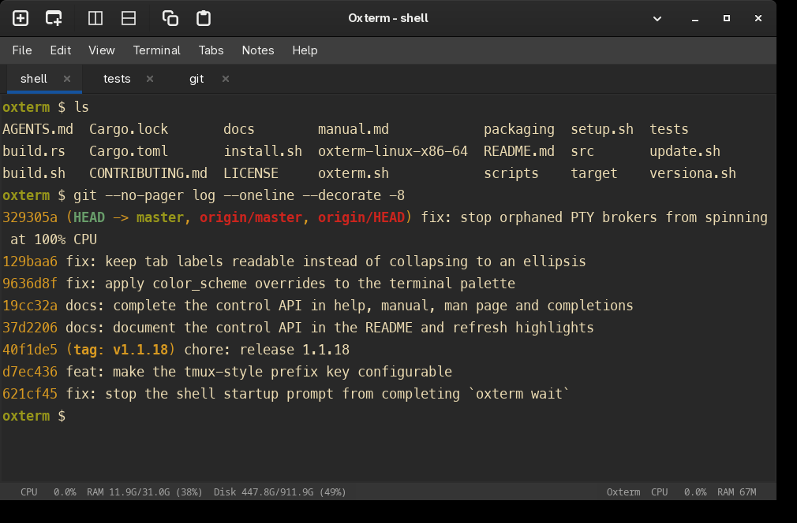
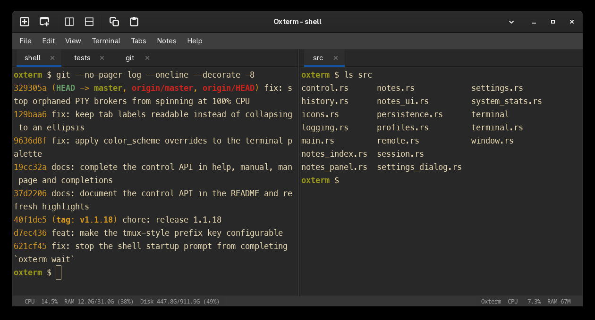
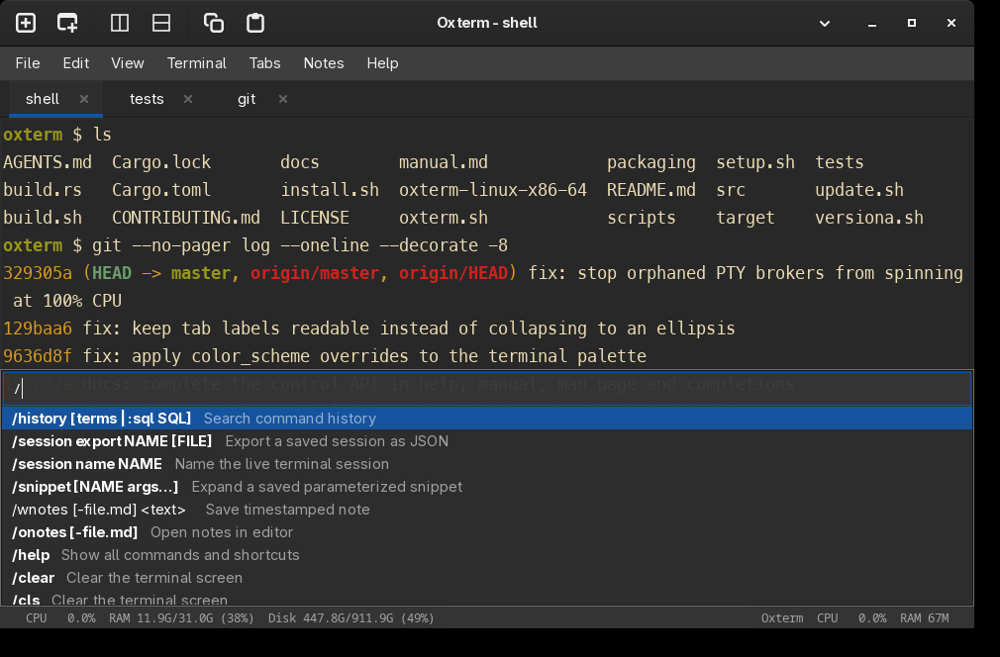

# Oxterm

[](https://github.com/buzzqw/oxterm/actions/workflows/ci.yml)
[](https://github.com/buzzqw/oxterm/actions/workflows/build.yml)
[](https://www.rust-lang.org/)
[](https://www.gtk.org/)
[](LICENSE)

**Oxterm** is a **lightweight, fast, and secure** native Linux terminal
emulator written in Rust with GTK3 and VTE. It is a **complete and fully
functional** terminal: light on resources and quick to start, while providing
everything you expect from a modern terminal.

The project combines a full terminal emulator with tabs, split panes, command
history, notes, shell integration, profiles, and sessions — all with a small
memory footprint and the memory-safety guarantees of Rust.

> **Quick start:** prebuilt Linux executables are already available on the
> [GitHub Releases page](https://github.com/buzzqw/oxterm/releases/latest). This
> is the easiest way to use Oxterm; you do not need Rust or development packages
> if you download a release binary.

- **[English user manual](manual.md)**
- **[Terminal compatibility](docs/compatibility.md)**
- **[Report an issue](https://github.com/buzzqw/oxterm/issues)**

## Highlights

- Native GTK3/VTE terminal with 256 colors and true-color support
- Tabs with reorder, rename, move, detach, independent windows, and a
  **Tabs > Move Tab from Another Oxterm…** command that adopts a running tab
  from another Oxterm window and closes it there
- tmux-like single, vertical, and horizontal split layouts, with a configurable prefix key (`Ctrl+B` by default)
- 247 built-in themes, optional drop-in Ghostty/iTerm2 theme files, automatic light/dark switching, configurable font, colors, 16-color palettes, cursor, opacity, padding, and encoding
- Typography controls: antialiasing and hinting, cell height and width scaling, optional HarfBuzz shaping, and ligature-friendly fonts
- Live Preferences reload without restarting the application
- SQLite command history with reverse search, filters, read-only SQL, replay, command duration, and Git branch metadata
- Scrollback search with match navigation, clickable `http`/`https` links, and broadcast input across panes
- Timestamped Markdown notes with an in-app Notes menu, a searchable Notes panel (SQLite FTS5) with `#tags` and preview, per-entry context, and configurable editor integration
- OSC 133 shell integration for prompts, command boundaries, and exit status
- Sticky command header, failure marks on the scrollbar, and open-output-in-pager
- Smart command-finished notifications: only when the terminal is unfocused or a command runs long, with failures always reported, plus a red dot on tabs whose last command failed
- Scriptable control API: `new`, `split`, `send`, `capture`, and `wait` against a running window
- VI copy mode with motions, text objects, visual block selection, scrolloff, and bookmarks
- Session restore, named sessions, profiles, command palette, quickmarks, and hints
- Compact right-click menu with submenus for clipboard (text/HTML/all/last
  command), links and paths, tabs, splits, tools, zoom, read-only, quickmarks,
  snippets, and notes actions
- Persistent PTY broker with SSH-friendly remote attach/detach, session listing, and multi-client terminal sharing
- Parameterized snippets and JSON export for saved sessions
- System statistics for the local and remote host (CPU, memory, disk), SSH connection sharing with keepalives, `autossh` support, and `mosh` recognition
- Optional close confirmation only when a terminal has an active foreground process

## Screenshots



| Split panes | Command bar |
| :---: | :---: |
|  |  |

The images come from an isolated profile running the release build, so they
never contain real settings or shell history. Regenerate them after a UI change
with `scripts/capture-screenshots.sh`; the script header lists the tools it
needs (Xvnc, xdotool, ImageMagick, xfwm4).

## Requirements

### Using a release binary

You only need a Linux system with GTK3 and VTE 2.91 runtime libraries. Download
the latest executable from the [GitHub Releases
page](https://github.com/buzzqw/oxterm/releases/latest), make it executable, and
run it.

### Building from source

Source builds need:

- Rust stable and Cargo
- GTK3 development files
- VTE 2.91 development files, version 0.70 or newer (Debian 12 ships 0.70;
  Arch, Fedora and Ubuntu 24.04 ship newer releases). Two settings need 0.74
  and are ignored, with a warning, on an older VTE; see
  [docs/compatibility.md](docs/compatibility.md#the-oldest-supported-vte-is-070).
- `pkg-config`

On Debian or Ubuntu:

```bash
sudo apt update
sudo apt install build-essential pkg-config libgtk-3-dev libvte-2.91-dev
```

On Arch Linux:

```bash
sudo pacman -S base-devel rust gtk3 vte3
```

Install Rust with [rustup](https://rustup.rs/) if it is not already available.

### Arch Linux (AUR)

The `oxterm` package builds the latest tagged release from source with the
system GTK3/VTE libraries. Once the package is published in the AUR:

```bash
yay -S oxterm        # or: paru -S oxterm
```

The `PKGBUILD` lives in [`packaging/aur`](packaging/aur) and is validated by CI
on every change.

## Build and Run

Clone the repository and build the optimized executable:

```bash
git clone https://github.com/buzzqw/oxterm.git
cd oxterm
cargo build --release --locked
./target/release/oxterm
```

To create the definitive release binary in the project root, run:

```bash
./build.sh
./oxterm-linux-x86-64
```

`build.sh` runs the locked release build and copies the result to
`oxterm-linux-x86-64`. The generated root binary is ignored by Git.

The launcher uses the release binary when available and falls back to the debug
binary:

```bash
./oxterm.sh
```

The repository includes local build hooks. Configure them with
`git config core.hooksPath .githooks`; `./setup.sh` also configures them as part
of its per-user installation. After each commit, the hook builds
`oxterm-linux-x86-64` in the project root. The generated file is ignored by
Git. The displayed Oxterm version uses the Cargo version plus the total Git
commit count as SemVer build metadata, for example
`MAJOR.MINOR.PATCH+<commit-count>`. Builds without Git metadata show the
plain release version.

Install the executable, desktop entry, manual page, shell completions, and
documentation under `~/.local`:

```bash
./setup.sh
```

The installation prefix can be changed with `PREFIX`; it must be a directory
writable by your user (use `./install.sh` for `/usr/bin`):

```bash
PREFIX="${HOME}/.local/opt" ./setup.sh
```

To build and install the current source version system-wide as `/usr/bin/oxterm`, run:

```bash
./install.sh
```

The script always rebuilds the release binary before installing it and asks for
`sudo` only when it needs permission to write the system installation
directories. It installs the executable, desktop launcher, manual page, shell
completions, documentation, and Oxterm ox icon system-wide. Run it again after
building a newer version so the system command and launcher point to the new
binary.

### Updating an existing clone

Compiled binaries are not tracked by Git, so a plain `git pull` only updates
the sources. Use the update helper instead:

```bash
./update.sh
```

`update.sh` pulls the latest changes, builds the release binary, refreshes
`oxterm-linux-x86-64`, and runs the installer (`/usr/bin` when writable or via
`sudo`, otherwise `~/.local`). It accepts `--user` to force the per-user
install, `--no-pull` to build the current checkout, and `--no-install` to stop
after the build.

`./setup.sh`, `./install.sh`, and `./update.sh` enable the repository hooks, so
later `git pull` commands rebuild automatically through the `post-merge` (or
`post-rewrite` for rebased pulls) hook. The hook refreshes a per-user
installation directly and a system-wide installation only when `sudo` needs no
password; otherwise run `./update.sh` after the pull. When Oxterm is installed
from the AUR package, `yay -Syu` updates it instead.

## Command Line

<!-- BEGIN GENERATED HELP -->
```text
Usage: oxterm [DIRECTORY] [OPTIONS] [-e CMD...]

Options:
  -w, --working-directory DIR   Working directory for the new terminal
      --new-window              Open a new window instead of reusing a running instance
      --no-restore              Do not restore the last session
  -T, --title TITLE             Set a fixed window title (apps cannot override it)
  -g, --geometry COLSxROWS      Initial size in character cells (e.g. 120x40)
  -F, --fullscreen              Start in fullscreen mode
  -m, --maximize                Start maximized
      --class CLASS             Set the WM_CLASS class part (window manager rules)
      --name NAME               Set the WM_CLASS instance name
  -p, --profile NAME            Start with a saved profile (session only)
      --config FILE             Use an alternative settings file
  -o, --option KEY=VALUE        Override a setting for this session (repeatable)
      --font FAMILY             Override the font family for this session
      --font-size N             Override the font size for this session
      --hold                    Keep the terminal open after the command exits
  -e, --execute CMD...          Run a command instead of the configured shell
  -V, --version                 Show the Oxterm version
  -h, --help                    Show this help
      --                        Treat the next argument as the directory

Remote sessions:
      --list                    List active Oxterm terminals (first column is the session ID)
      --info SESSION_ID         Show one active terminal
  -a, --attach [SESSION_ID]     Share a live session in this terminal
  -M, --move [SESSION_ID]       Take a live session over in this terminal
      --detach SESSION_ID       Disconnect every remote client of a session
      --broker SOCKET ID        Run the persistent PTY broker (internal)

Inspection (no window is opened):
      --show-config             Print the effective settings as JSON and exit
      --default                 With --show-config, print the built-in defaults
      --validate-config [FILE]  Validate a settings file and exit
      --list-settings           List every setting with its type and default
      --list-themes             List the built-in color schemes
      --list-keybinds           List the keyboard shortcuts
      --list-actions            List the scriptable control actions
      --diagnostics             Print environment, paths and limits for bug reports

Utilities (no window is opened):
      --edit-config             Open the settings file in the configured editor
      --list-fonts              List installed font families for font_name

Scriptable control (acts on a running Oxterm, opens no window):
  new [--cwd DIR] [--title TITLE] [-- CMD...]                          Open a tab, print its pane id
  split [--pane ID] [--vertical|--horizontal] [--cwd DIR] [-- CMD...]  Split a single-pane window
  send [--pane ID] [--enter] TEXT...|-                                 Type into a pane
  capture [--pane ID] [--scrollback N|--all]                           Print a pane's text
  wait [--pane ID] [--timeout SECONDS]                                 Wait for the next command to finish

  These headless commands act on a running Oxterm terminal on the same
  host and open no window, so they are safe to use over SSH. Without a
  SESSION_ID, -a and -M use the only session or show a list to choose from.

  attach  Adds this terminal as another view of the session, repainting
          its current screen. The shell keeps running and its original
          window stays live; every view shares the same input and output.
  move    Like attach but takes control: it disconnects every other remote
          client and switches off the original window's view, so the
          session is shown only here. In that window, Ctrl+B then s or w
          brings the view back.
  detach  Releases every remote client (attach or move) without stopping
          the shell, leaving the original window as the only view again.
```
<!-- END GENERATED HELP -->

### Inspecting the configuration

The inspection commands open no window, need no display, and never modify the
settings file, so they are safe in scripts and over SSH:

```text
oxterm --show-config              # effective settings as JSON
oxterm --show-config --default    # built-in defaults only
oxterm --validate-config [FILE]   # check a file and report invalid keys
oxterm --list-settings            # every key, type, default and description
oxterm --list-themes              # color schemes and their fg/bg colors
oxterm --list-keybinds            # keyboard shortcuts
oxterm --list-actions             # scriptable control actions
oxterm --list-fonts               # font families for font_name
oxterm --edit-config              # edit settings.json in $EDITOR
oxterm --diagnostics              # versions, paths, permissions and limits
```

`-o KEY=VALUE` overrides are reflected by `--show-config` but are never written
to disk. The complete settings reference is generated from the same table as
these commands: [docs/settings.md](docs/settings.md).

### Scriptable control

A running Oxterm window also publishes a private control socket, so scripts,
editors, and coding agents can drive tabs and panes without a GUI:

```text
oxterm new [DIR] [--cwd DIR] [--title TITLE] [-- COMMAND...]
oxterm split [--pane ID] [--vertical|--horizontal] [--cwd DIR] [--title TITLE]
             [-- COMMAND...]
oxterm send [--pane ID] [--enter] TEXT...        # or: ... - (read stdin)
oxterm capture [--pane ID] [--scrollback N | --all]
oxterm wait [--pane ID] [--timeout SECONDS]
```

`new` and `split` print the id of the new pane; `split` refuses a window that
already has two panes. `new` also accepts a directory as its first positional
argument, as a shorthand for `--cwd`. `send` types into the target pane and,
with `--enter`, submits the line. `capture` prints the visible screen by
default, the last `N` lines of history with `--scrollback`, or the whole buffer
with `--all`. `wait` waits for the next command in the pane and exits with that
command's status, so a build can be chained and checked. None of them opens a
window.

The target pane comes from `--pane`, then `$OXTERM_PANE`, then the only open
pane. Exit statuses are `0` for success, `1` for a failed operation, `2` for a
usage error, `3` when the pane is not found, and `4` when no running Oxterm
window can be reached. See the [manual](manual.md#scriptable-control) for
details.

Examples:

```bash
oxterm ~/src/project
oxterm --working-directory ~/src/project
oxterm --title "Build" --geometry 120x40
oxterm --fullscreen
oxterm --new-window
oxterm --no-restore
oxterm --hold --execute make
oxterm --class MyTerm --name floating   # window-manager matching
oxterm --profile work                   # start with a saved profile
oxterm -o opacity=0.9 -o font_size=14    # ad-hoc setting overrides
oxterm --font "Fira Code" --font-size 13
oxterm --config ~/demo-settings.json     # throwaway configuration
oxterm --execute git status
oxterm --list                             # list terminals on this host
oxterm --info 12345-2                      # inspect one terminal
oxterm -a                                  # choose from the active terminals
oxterm -a 12345-2                          # attach to one terminal
oxterm -M                                  # move one here (detaches its other views)
oxterm -M 12345-2                          # move one terminal here
oxterm --detach 12345-2                   # release a remote attach
pane=$(oxterm split --horizontal --cwd ~/src/app)  # new pane, prints its id
oxterm send --pane "$pane" --enter 'make test'     # type into a pane
oxterm wait --pane "$pane" --timeout 600           # wait for the command
oxterm capture --pane "$pane" --scrollback 200     # read its output
```

`--option`, `--font`, `--font-size` and `--profile` overrides apply only to the
launched session and are never written back to your saved settings. `--config`
points Oxterm at an alternative settings file (handy for demos).

`--execute` consumes every following argument as part of the command, so it must
be the last option. `--` disables option parsing for the following directory
argument, which is useful when its name begins with `-`.

Without an explicit directory, Oxterm starts in the current working directory.

`oxterm --list`, `oxterm -a [SESSION_ID]` and `oxterm -M [SESSION_ID]` are
headless commands. They do not open a GTK window: they inspect, attach to, or
move the live broker session of a running Oxterm terminal on the same host.
Attaching repaints the session by replaying its most recent output, so the
current screen appears instead of an empty one. This makes them suitable for use
through SSH. Broker sockets are private
(`0700` directory, `0600` socket) and the broker process owns the child PTY, so
an unexpected GUI crash does not terminate the shell. When the configured
directory would make the Unix socket path too long, Oxterm falls back to
`/tmp/oxterm-<uid>/remote/` (also `0700`) so sessions keep working with a long
`$HOME`. An intentional GUI close
still terminates its attached tabs through the normal cleanup path, but a tab
whose local view was switched off (`Ctrl+B`, `d`) or taken over with `oxterm -M`
keeps running under its broker, so the session survives the close and can be
reached again with `-a`/`-M` or reclaimed from the original window. Multiple `-a`
clients may be connected at once; their input is forwarded to the same shell
and output is broadcast to each client. `-M` instead takes control: it detaches
every remote controller and turns off the local GUI view, so the chosen session
is shown only in the terminal that ran the command. In the original Oxterm
window, `Ctrl+B` then `s`/`w` brings it back. The listing includes the last
command/application received from the shell, with `running` while OSC 133
reports that command as active and `last` otherwise.

The internal `oxterm --broker SOCKET SESSION_ID` mode is started by the GUI and
is not normally invoked manually. Its framed Unix-socket protocol supports
`LIST`, `INFO`, `ATTACH`, `MOVE`, `DETACH`, `RENAME`, `COMMAND`, `LOCAL_ON`,
`LOCAL_OFF`, `KILL`, `IS_SSH`, `ECHO`, and `IS_ACTIVE`. Attached clients exchange
length-prefixed frames containing terminal input/output, and can detach without
stopping the broker. On attach the broker replays the most recent child output
(bounded to a fixed size) so the program's screen is repainted instead of
appearing blank, then nudges the foreground program to redraw. A reconnect still
cannot recover output older than that replay window. The broker removes its
socket after the shell exits. Brokers are event driven: a session left without a
GUI keeps its shell alive at no CPU cost, and a broker that stops making I/O
progress for a few seconds terminates itself instead of spinning on a stuck
descriptor.

The listing columns are `ID`, `NAME`, `TITLE`, `DIRECTORY`, `STATUS`,
`APPLICATION`, and `APP_STATUS`. `APP_STATUS` is `running` while the command is
active and `last` after completion.

When **Confirm before closing active terminals** is enabled in Preferences,
closing a window asks for confirmation only if one of its terminal tabs has an
active foreground process. A shell waiting at its prompt closes immediately.

## Built-in Commands

Commands beginning with `/` are handled by Oxterm:

| Command | Purpose |
| --- | --- |
| `/help` | Show the command reference |
| `/history [terms]` | Search command history using AND filters |
| `/history :sql SELECT ...` | Run a read-only history query |
| `/wnotes [-file.md] <text>` | Save a timestamped note |
| `/onotes [-file.md]` | Open a notes file in the configured editor |
| `/learn <file>` | Import commands into history without executing them |
| `/optimize history` | Keep latest command/directory entries and optimize history in background |
| `/session export NAME [FILE]` | Export a saved session as private JSON |
| `/session name NAME` | Assign a stable name shown by remote listing |
| `/session list` | List saved sessions |
| `/snippet add NAME COMMAND` | Save a parameterized command snippet |
| `/snippet NAME [ARGS...]` | Expand a snippet into the prompt without executing it |
| `/snippet list` | List saved snippets |
| `/snippet delete NAME` | Remove a saved snippet |
| `/clear` / `/cls` | Clear the terminal screen |

The **Notes** menu also provides the integrated Notes panel (full-text search,
tags, preview, append) plus New Note, Add Selection to Note, Copy All to Note,
Note Command Output, Open Note, and Open Notes Folder actions (see the manual).

Press `Ctrl+Shift+P` for the command palette and `Tab` after `/` for command
completion.

## Keyboard Shortcuts

| Shortcut | Action |
| --- | --- |
| `Ctrl+Shift+T` | New tab |
| `Ctrl+Shift+N` | New window |
| `Ctrl+Shift+W` | Close tab |
| `Ctrl+Shift+Q` | Close window |
| `Ctrl+Shift+C` / `Ctrl+Shift+V` | Copy / paste |
| `Ctrl+Shift+A` | Select all |
| `Ctrl+Shift+S` | Rename tab |
| `Ctrl+Shift+R` | Reset terminal |
| `Ctrl+Shift+X` | Reset and clear terminal |
| `Ctrl+Shift+F` | Search the scrollback (Enter/Shift+Enter = next/prev) |
| `Ctrl++` / `Ctrl+-` / `Ctrl+0` | Zoom font in / out / reset |
| `Ctrl+Shift+E` / `Ctrl+Shift+D` | Vertical / horizontal split |
| `Ctrl+Shift+M` / `Ctrl+M` | Set / jump to quickmark |
| `Ctrl+Shift+H` | Hint mode for URLs, paths, and Git SHAs |
| `Ctrl+Shift+Y` | VI-style copy mode |
| `Ctrl+Shift+B` | Toggle broadcast input |
| `click` | Open the URL under the cursor |
| `Ctrl+R` | Interactive history search; repeat to cycle matches |
| `Ctrl+PageUp` / `Ctrl+PageDown` | Previous / next tab |
| `Ctrl+Shift+PageUp` / `Ctrl+Shift+PageDown` | Move tab |
| `Ctrl+Alt+PageUp` | Switch split pane |
| `Ctrl+Shift+Up` / `Ctrl+Shift+Down` | Previous / next OSC 133 prompt |
| `Ctrl+Shift+P` | Command palette |
| `Ctrl+B`, then `c` | New tab (tmux-compatible) |
| `Ctrl+B`, then `n` / `p` | Next / previous tab |
| `Ctrl+B`, then `%` / `"` | Vertical / horizontal split |
| `Ctrl+B`, then `o` | Switch split pane |
| `Ctrl+B`, then `s` / `w` | Show the interactive terminal list |
| `Ctrl+B`, then `d` | Detach the local terminal PTY |
| `Ctrl+B`, then `x` | Close tab |
| `Alt+1` ... `Alt+9` | Replay one of the 9 most recent history entries (at the shell prompt) |
| `F11` | Fullscreen |

Any other key after the prefix is passed to the running program together with
the prefix. The prefix defaults to `Ctrl+B` and can be changed under
Preferences → Input → "tmux-style prefix keys" and the "Prefix key (Ctrl+)"
field. Set it to `Ctrl+A` (or turn the prefix off) when you use tmux or screen
inside Oxterm and need `Ctrl+B` to reach them.

## Configuration and Data

Oxterm intentionally uses the existing shared data directory:

```text
~/.config/oxterm/settings.json   Preferences
~/.config/oxterm/settings.json.bak Previous valid Preferences snapshot
~/.config/oxterm/history.db      SQLite command history
~/.config/oxterm/sessions/       Saved sessions
~/.config/oxterm/profiles/       Named profiles
~/.config/oxterm/remote/         Private broker sockets
~/.config/oxterm/themes/         Drop-in Ghostty and iTerm2 theme files
/tmp/oxterm-<uid>/remote/        Fallback broker sockets when that path is too long
```

### Themes

Oxterm ships **247 themes embedded in the binary**: Catppuccin, Dracula,
Tokyo Night, One Dark, Rose Pine, Kanagawa, Everforest, Gruvbox, Nord,
Solarized, GitHub, Ayu, Material, Nightfox, the full redistributable
iTerm2-Color-Schemes collection, and many more. There is nothing to download
or copy: pick one in **Preferences → Appearance** or with `color_scheme`, and
`oxterm --list-themes` prints the full list.

Custom themes are optional. Drop a Ghostty-style theme file or an iTerm2
`.itermcolors` file into `~/.config/oxterm/themes/` and it appears in the list
on the next start; the file name becomes the theme name.

Automatic light/dark switching uses the desktop's GTK dark-mode preference:

```json
{
  "auto_theme": true,
  "theme_light": "Catppuccin Latte",
  "theme_dark": "Catppuccin Mocha"
}
```

With `auto_theme` enabled, Oxterm follows the desktop when it changes
appearance (for example at sunset) and re-colors open terminals immediately.

### Notifications and failure markers

With **Preferences → Notifications → Notify when a command finishes** enabled (requires
OSC 133 shell integration), Oxterm sends a desktop notification only when it is
useful:

- commands that finish while the terminal has focus stay silent;
- successful commands shorter than `notify_min_seconds` (10s by default) stay
  silent;
- failed commands always notify, so a test suite that dies in two seconds still
  gets your attention.

The body names the command, its exit code, the duration and the directory. The
three knobs are `bell_notification`, `notify_only_unfocused`,
`notify_min_seconds` and `notify_on_failure`.

A tab whose last command failed gets a red dot; it disappears when you select
that tab (or when the next command succeeds). When a command fails while you
are watching its tab, no dot is shown because you can already see the error.

Compatibility switches live under **Preferences → Compatibility**: bold text
using bright colors, inline Sixel images, and OSC 133. Pixel-smooth scrolling is
on the **Scrolling** page, and the characters treated as part of a word by
double-click selection are on the **Input** page.

Open **Edit > Preferences** to configure the terminal, appearance, colors,
scrolling, input, notifications, compatibility, and notes. The filter box at the
top searches every page, and each setting shows its explanation under its name.
Most changes are applied immediately.

URLs opened from terminal output are restricted to `http://` and `https://`.
Links using other schemes are not passed to desktop URL handlers.

The `master` branch also publishes a rolling prerelease after every successful
push: [Oxterm latest](https://github.com/buzzqw/oxterm/releases/tag/latest).
It contains the Linux executable and `SHA256SUMS`. The release is intended for
testing and is replaced by the next successful master build.

## Development

Run the standard checks before submitting changes:

```bash
cargo fmt --check
cargo test --all-targets --locked
cargo build --release --locked
```

`src/headless/` is the display-free core: command line and control-command
parsing, the settings schema and validation, JSON framing, diagnostics and the
pure VI copy-mode helpers. It must not import GTK or VTE; `tests/headless.rs`
enforces the boundary, and `cargo test --lib` runs it without a display.

The suite also covers frame bounds, metadata sanitization, history and client
buffering. `tests/remote_broker.rs` starts the release binary as a real broker
with two PTYs and verifies control commands, multi-client input/output, local
forwarding toggles, detach, socket permissions, and cleanup. Run that
integration test alone with:

```bash
cargo test --test remote_broker -- --nocapture
```

### Generated documentation

`--help`, the OPTIONS section of the man page, the bash/fish/zsh completions,
`docs/settings.md`, the shortcut table in the manual and the command line block
above are generated from `src/headless/spec.rs`. After changing an option, a
setting or a description, regenerate and commit the result:

```bash
cargo run --bin oxterm-docgen
cargo run --bin oxterm-docgen -- --check   # what CI runs
```

### Benchmarks

Two dependency-free benchmarks guard the "lightweight and fast" promise. The
core benchmark measures the hot headless paths; the startup benchmark measures
the real binary, including GUI readiness, tab creation and RSS. Two further
scripts look outward: one compares Oxterm head to head with other terminals
(Ghostty, Alacritty and xfce4-terminal by default), and one measures the
input-to-model latency of the control path.

```bash
cargo run --release --example bench-core
cargo run --release --example bench-core -- --check

./scripts/bench-startup.sh                  # needs DISPLAY or WAYLAND_DISPLAY for the GUI part
./scripts/bench-startup.sh --check
./scripts/bench-startup.sh --write-baseline # after an intentional change
```

Reference numbers on a warm cache, release build, minimum of five runs (exact
values depend on the machine and are only meant to show the order of magnitude):

| Measurement | Reference |
| --- | --- |
| CLI parse (one invocation) | ~0.3 µs |
| Effective defaults / validate all settings | ~9 µs / ~2 µs |
| Load and validate a settings document | ~12 µs |
| VI word motion (8 hops, long line) | ~6 µs |
| JSON frame round trip | ~0.6 µs |
| `--version` / `--list-settings` | ~27 ms |
| Window ready, including the first shell | ~300 ms |
| Five new tabs through the control API | ~400 ms |
| RSS with the idle window / after five tabs | ~44 MB / ~46 MB |

Baselines live in `bench/`. `--check` compares against them and exits non-zero
past a tolerance (`BENCH_TOLERANCE`, default 4x for startup and 5x for the
core; CI uses 6x for startup). The GUI startup figure is the best of
`BENCH_GUI_ATTEMPTS` launches (default 3) so a single slow cold start does not
fail the guard. The limits are deliberately generous: they catch algorithmic
and packaging regressions, not run-to-run noise. Regenerate a baseline only
when a change is understood and intended.

#### Head to head with Ghostty, Alacritty and xfce4-terminal

`scripts/bench-compare.sh` launches Oxterm and its opponents on the same display
with an isolated `HOME`, so all of them see their default configuration, and
reports the minimum of several runs:

```bash
sudo pacman -S ghostty alacritty xfce4-terminal xdotool  # opponents are optional
./scripts/bench-compare.sh --table          # Markdown table
./scripts/bench-compare.sh --check          # regression guard per terminal
BENCH_OPPONENTS="ghostty xfce4-terminal" ./scripts/bench-compare.sh
XFCE4_TERMINAL_BIN=/path/to/xfce4-terminal ./scripts/bench-compare.sh
```

Measured on a desktop with an AMD Ryzen 7 5800H (8 cores, 16 threads, Radeon
Vega integrated graphics) running CachyOS with kernel 7.2.11-1 in an X11
session at 1920x1080, default configuration, font size 12, release build,
minimum of three runs; absolute values depend on the machine and on its load:

| Measurement | Oxterm | Ghostty 1.3.1 | Alacritty 0.17.0 | xfce4-terminal 1.2.0 |
| --- | --- | --- | --- | --- |
| Spawn to first visible window | 572 ms | 667 ms | **424 ms** | 666 ms |
| Idle CPU over 5 s, no payload | 5.7 ms | 24.7 ms | **0.0 ms** | **0.0 ms** |
| Spawn to the command inside the terminal | **135 ms** | 422 ms | 271 ms | 269 ms |
| Drain 100 000 ANSI-coloured lines (8.8 MB) | **123 ms** | 325 ms | 247 ms | 257 ms |
| Drain 100 000 plain lines (8.0 MB) | **105 ms** | 194 ms | 233 ms | 183 ms |
| Drain the plain payload in 80-byte writes (8.0 MB) | 303 ms | **296 ms** | 305 ms | 378 ms |
| CPU to drain ANSI, terminal only | 332.4 ms | 510.0 ms | 253.3 ms | **189.6 ms** |
| CPU to drain ANSI, GUI process | 251.4 ms | 461.0 ms | 212.3 ms | **179.2 ms** |
| CPU to drain plain, terminal only | 270.2 ms | 307.2 ms | 239.0 ms | **129.2 ms** |
| CPU to drain 80-byte writes, terminal only | 389.8 ms | 525.6 ms | 266.9 ms | **252.0 ms** |
| 20 window resizes | 219 ms | **115 ms** | 282 ms | 455 ms |
| CPU for the 20 resizes | 38.1 ms | 46.0 ms | 24.6 ms | **20.3 ms** |
| Close window to process exit | **17 ms** | 58 ms | 24 ms | 21 ms |
| Total tree RSS when idle | 118 MB | 170 MB | 116 MB | **80 MB** |
| Peak tree RSS under the ANSI payload | 122 MB | 177 MB | 131 MB | **78 MB** |

Bold marks the best value in each row.

CPU time is the more informative row: wall time in the drain test is bounded by
how each terminal acknowledges PTY output, while CPU time shows what the
machine actually spends. It is sampled from the threads of the terminal's own
processes (`schedstat`), excluding the shell and the payload command, so it
covers Oxterm's PTY broker and the renderer and PTY threads of Ghostty,
Alacritty and xfce4-terminal alike. The "terminal only" row sums every thread
and helper of the terminal, while the "GUI process" row is only the process the
script launched: for Oxterm the difference is the broker.

Five of those rows are separate experiments, all on the same defaults:

- **Idle CPU** is sampled over five seconds after a half-second settle on an
  empty window. It counts cursor blink, timers and helper wakeups. Alacritty's
  and xfce4-terminal's default cursors do not blink and neither arms a periodic
  timer, so both measure zero; Oxterm's blinking cursor and periodic timers
  cost 5.7 ms, Ghostty's 24.7 ms.
- **Plain lines** are the same workload without the SGR sequences, so comparing
  the two drain rows shows what the colour handling and the extra 0.8 MB cost:
  18 ms for Oxterm, 131 ms for Ghostty, 14 ms for Alacritty and 74 ms for
  xfce4-terminal.
- **80-byte writes** feed the plain payload through `dd bs=80`, one write per
  line, to measure per-write overhead rather than bulk throughput. Wall time
  collapses to roughly the same 296-305 ms for Ghostty, Oxterm and Alacritty
  (378 ms for xfce4-terminal) because the writer now paces them; the CPU row
  shows what the extra wakeups cost each terminal: 389.8 ms for Oxterm, still
  above Alacritty's 266.9 ms and xfce4-terminal's 252.0 ms because of the
  broker hop, while Ghostty pays the most (525.6 ms).
- **20 resizes** alternate a window between two sizes with `xdotool` on an empty
  pane. The wall time includes xdotool, X11 and window-manager latency, the CPU
  count includes a 200 ms settle so the last resize is applied.
- **Close** sends `WM_DELETE_WINDOW` (`xdotool windowquit`) and waits for the
  process to leave the process table, which covers shutdown and cleanup rather
  than a signal.

Oxterm is the fastest where the user feels it: the command inside the terminal
starts at 135 ms against 269 ms for xfce4-terminal, 271 ms for Alacritty and
422 ms for Ghostty, and both payloads drain in about half the time of the next
fastest (123 ms ANSI and 105 ms plain, against 247/233 ms for Alacritty,
257/183 ms for xfce4-terminal and 325/194 ms for Ghostty). It also closes
fastest (17 ms) and keeps idle CPU at 5.7 ms, against Ghostty's 24.7 ms. Ghostty wins the resize storm's wall time (115 ms
against 219 ms), where its renderer applies the new size sooner, but it is the
slowest to start and to reach the command. Alacritty maps its window first
(424 ms against 572 ms for Oxterm and 666/667 ms for xfce4-terminal and
Ghostty).

xfce4-terminal is the closest peer: it uses the same VTE parser, grid and
renderer without Oxterm's broker, and it sets the efficiency floor. It spends
the least CPU on the ANSI payload (189.6 ms against 332.4 ms for Oxterm,
253.3 ms for Alacritty and 510.0 ms for Ghostty), the least on the plain and
write-bound payloads, and the least memory (80 MB idle against 118 MB for
Oxterm and 116 MB for Alacritty). Of Oxterm's 332.4 ms, 81.0 ms is its PTY
broker — the difference between the terminal-only and GUI-process rows.
xfce4-terminal pays for that economy on wall time: it is the slowest in the
resize storm (455 ms) and lands with Alacritty in the middle of the throughput
ranking. Startup to a mapped window is the one row where the four stay within a
factor of 1.6: Alacritty leads at 424 ms, Oxterm follows at 572 ms, and Ghostty
and xfce4-terminal are tied at the back.

Read the wall figures as order-of-magnitude results: they move between sessions
with the machine's load. What the script cannot see is the smoothness, frame
pacing and rendering quality of the GPU terminals, which is their actual
strength; the next section bounds Oxterm's own input path, but does not compare
it with them.

The window metrics need X11 and `xdotool`; Wayland-only sessions are not
supported yet (run the script under `xvfb-run` in CI). Windows are matched by
`_NET_WM_PID`, because Ghostty ignores `--class` on X11. `BENCH_OPPONENTS`
selects the opponents to measure, `GHOSTTY_BIN`, `ALACRITTY_BIN` and
`XFCE4_TERMINAL_BIN` point at non-standard binaries, `BENCH_GHOSTTY_ARGS`,
`BENCH_ALACRITTY_ARGS` and `BENCH_XFCE4_TERMINAL_ARGS` pass extra flags,
`BENCH_PAYLOAD_LINES` resizes the payload, `BENCH_IDLE_SECONDS` and
`BENCH_RESIZE_STEPS` size the two new tests and `BENCH_FONT_SIZE` sets the font
size used by all of them.

Two caveats apply. `drain_ms` stops when the payload command returns, which is
bounded by how each terminal reads and acknowledges PTY output: it is an
order-of-magnitude throughput figure, not a rendering benchmark, and the GPU
frame times of Ghostty and Alacritty — their actual strength — are not measured
here. Tree RSS counts the PTY broker and the shell, which is why it is larger
than the single-process figures reported above. xfce4-terminal shares Oxterm's
VTE core, so its rows bound what that core costs without the broker rather than
describing a separate rendering architecture.

#### Input latency

`scripts/bench-latency.py` types a unique marker into a running pane through the
control socket and polls `capture` until the marker appears in the terminal's
text model. That covers the part of the input path Oxterm controls: keystroke,
control socket, GUI PTY, broker, shell PTY, line-discipline echo and back into
VTE. Two baselines keep the numbers honest: `ping` is a no-op control round
trip and `capture` is one screen-text extraction.

```bash
./scripts/bench-latency.py --table
./scripts/bench-latency.py --runs 200
./scripts/bench-latency.py --variant fast:cursor_blink=false,text_shaping=false
```

| Variant | ping p50 | capture p50 | echo p50 | echo p95 |
| --- | --- | --- | --- | --- |
| defaults | 0.30 ms | 0.25 ms | 16.2 ms | 17.3 ms |
| no-blink | 0.30 ms | 0.24 ms | 16.3 ms | 17.3 ms |
| transparency | 0.41 ms | 0.37 ms | 16.2 ms | 17.2 ms |
| no-shaping | 0.15 ms | 0.09 ms | 16.2 ms | 17.3 ms |
| fast | 0.31 ms | 0.28 ms | 16.2 ms | 17.2 ms |

The round trip is one 60 Hz frame for every variant: transparency, cursor
blink, shaping and smooth scrolling do not move it, because the limit is VTE's
processing cadence rather than anything Oxterm adds. The broker and the control
API together stay below 0.5 ms, which is the useful negative result of this
measurement — it says not to trade visual features for input latency.

What it does not measure is input to photon. Frame pacing, compositor latency
and glyph rasterization need frame-level timestamps from a renderer, which is
exactly where GPU terminals like Ghostty and Alacritty are expected to win.

#### What the PTY broker costs

The broker relays every byte between two PTYs. Across the measurement sets it
accounts for roughly half of the CPU Oxterm spends draining the 8.8 MB payload
— about as much as VTE itself. Two experiments shaped the conclusion:

- Moving the two relay directions from 8 KiB to 64 KiB reads changed neither
  drain time nor CPU beyond run-to-run noise (±17% across rounds, both
  directions), so the cost is the per-byte copy, not the syscall count.
- Lowering the broker's idle wakeup from 100 ms to 10 ms left the input round
  trip at 16.3 ms, so the broker is not where the frame of latency comes from.

Two later changes were measured the same way (old and new binary, five runs,
alternated, twice). The broker no longer polls the GUI PTY size every 100 ms:
the GUI sends it a `SIGWINCH` when the grid changes, with a 1 s safety-net poll,
and idle CPU of the whole tree went from 9.0 ms to about 6.3 ms over five
seconds. Recording the replay buffer in bulk, writing straight to the GUI PTY
when nothing is queued and building the client frame only when a client is
attached did not move the drain CPU (326-332 ms before and after): what the
broker spends is the two PTY writes in the kernel, not user-space copying.

A `splice`-based relay is the next step if per-byte CPU ever becomes a
priority; it is deliberately not done yet, because it complicates the remote
client fan-out for no measured gain in wall time.

Read the rest of the table the same way: Oxterm is a GTK3 frontend that
delegates the parser, the grid and the drawing to VTE, while Ghostty and
Alacritty ship their own cores with GPU renderers. The comparison is a fair
end-to-end verdict on the products, but it measures VTE+GTK against those cores
— not Oxterm's own code.

The GitHub Actions workflows run the same checks, the documentation check, the
GUI tests under Xvfb and the benchmark checks, and build an x86_64 release artifact
on every commit push, pull request, and manual workflow dispatch on any branch.
Version tags also trigger versioned release artifacts and checksum generation.

For maintainers, release automation is available through:

```bash
./versiona.sh --dry-run
./versiona.sh
```

The normal release flow updates both `Cargo.toml` and `Cargo.lock`, creates an
annotated version tag, pushes the branch and tag, and publishes the GitHub
release. Use `--dry-run` to inspect the next version and release notes without
changing files or Git refs.

## Support

If Oxterm is useful to you, you can support development through
[PayPal](https://www.paypal.com/cgi-bin/webscr?cmd=_donations&business=azanzani@gmail.com&item_name=Support+Oxterm+Project).

## License

Oxterm is distributed under the [European Union Public Licence 1.2](LICENSE).

Copyright 2026 Andres Zanzani.
